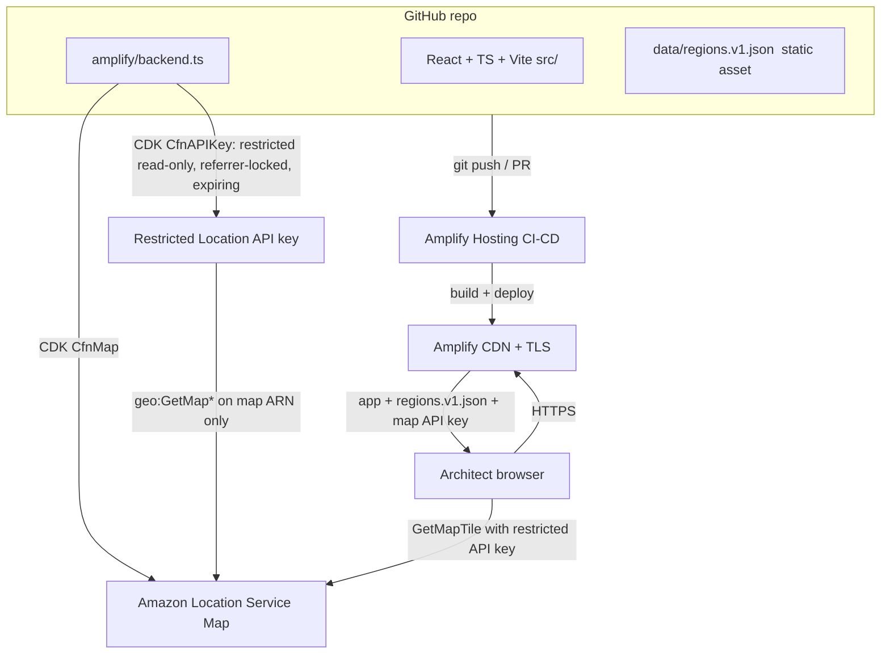

# AWS Region Resilience Explorer — Architecture

**Project:** AWS Region Resilience Explorer
**Event:** AWS Builder Center "Map It" hackathon
**Deadline:** 2026-11-02
**Author (owner):** map-architect
**Status:** DRAFT — awaiting lead review (gate before implementation)

---

## 1. Product summary

An interactive world map that helps AWS architects *see* the geographic
separation between AWS Regions and reason about secondary Regions for
disaster recovery (DR).

The product delivers **insight**, not just markers:

1. Show AWS Regions on an interactive map.
2. Pick a **primary** Region.
3. Compare candidate **secondary** Regions.
4. Compute and draw approximate **great-circle (haversine)** distances.
5. Filter Regions by verified metadata (continent, launch year, AZ count, geography type).
6. Make it unmistakably clear that **distance alone is not resilience** —
   it is not latency, not fault isolation, not service availability, not compliance.

The disclaimer is a first-class product feature, not fine print. Honest
framing of what the map does and does not model is part of the real-world
usefulness we are judged on.

---

## 2. Required stack (design target)

| Layer | Choice |
|---|---|
| App framework | **AWS Amplify Gen 2** |
| Frontend | **React + TypeScript + Vite** |
| Hosting / CI-CD | **AWS Amplify Hosting** with **GitHub** CI/CD |
| Interactive map | **Amazon Location Service** (Maps) |
| Infra-as-code | **AWS CDK** constructs wired through `amplify/backend.ts` |
| Data | **Versioned static JSON** dataset of Region locations + metadata (see `DATA_CONTRACT.md`) |
| Shape | Primarily **static + serverless**; **no** unnecessary backend services (Lambda, API Gateway, DynamoDB) and **no** user auth |

**Final confirmed stack:** AWS Amplify Gen 2; React + TypeScript + Vite; Amazon
Location Service; GitHub CI/CD with Amplify Hosting; a versioned static JSON
dataset; no unnecessary backend services; and **no deployment without explicit
human approval** (see §7).

---

## 3. Service selection & justification

| Service | Why | Why not the alternative |
|---|---|---|
| **Amplify Gen 2** | TypeScript-first backend definition (`amplify/backend.ts`), per-branch cloud sandboxes, native GitHub CI/CD, and an escape hatch to raw CDK for resources Amplify has no first-class construct for (Location maps). Lowest-ceremony path from repo → deployed app. | Hand-rolled CDK app + separate hosting (S3/CloudFront) is more wiring and no CI/CD out of the box. SAM is Lambda-centric; we are static. |
| **Amplify Hosting** | Git-push-to-deploy, PR preview builds, managed TLS + CDN, atomic rollbacks. Free tier covers hackathon traffic. | Self-managed S3 + CloudFront needs manual invalidations and cert setup. |
| **Amazon Location Service (Maps)** | The judging criterion explicitly rewards use of Location Service. Vector basemaps, MapLibre GL JS rendering, usage-based pricing with a free tier. We draw our own Region markers + great-circle lines as GeoJSON layers on top. | Mapbox/Google would score worse against the "use of Amazon Location Service" criterion and add third-party billing. |
| **Amazon Location Service restricted API key** (chosen) | Simplest moving parts for a public, read-only, login-less map: a referrer/origin-restricted, read-only, expiring key bound to the single map ARN. No identity-pool wiring, no client credential exchange. | See §5 — the unauth Cognito identity pool is more secure via IAM but adds wiring that is unnecessary when there is no login. |
| **AWS CDK (via Amplify)** | Amplify Gen 2 has no first-class `defineMap`, so we add the `CfnMap` (+ `CfnAPIKey`) as CDK constructs inside the Amplify backend. One deploy, one IAM surface. | A separately-deployed CDK stack would split state and complicate cross-stack references. |
| **Static versioned JSON** | Region data changes rarely (new Region launches). Shipping it as a build-time asset = zero backend compute, zero query latency, trivially cacheable, diffable in git. | DynamoDB/API Gateway/Lambda would add cost, cold starts, and operational surface for data that is effectively a constant. |

**Net:** one Amplify app, one map resource, one restricted API key, one static
JSON asset. No databases, no APIs, no servers to patch.

---

## 4. How Amplify Gen 2 integrates Amazon Location Service

Amplify Gen 2 defines the backend declaratively in `amplify/backend.ts`. Amplify
ships first-class `defineAuth`, `defineData`, etc., but **not** a Location map
primitive. The supported pattern is to reach the underlying CDK stack and add
the resource as a CDK construct.

Flow:

1. In `amplify/backend.ts`, create a backend CDK stack and add an `aws-location`
   **`CfnMap`** construct (a vector style such as a standard street/light basemap).
2. Add a **`CfnAPIKey`** construct (or documented equivalent) that is
   **restricted** to that single map's ARN, **read-only** (`geo:GetMap*`),
   **referrer/origin-restricted** to the Amplify Hosting domain(s), and carries an
   **expiry** (see §5).
3. No identity pool and no login: because the product has no authenticated users,
   `defineAuth` / an unauth role is **not** wired for map access.
4. Surface the map name, Region, and the API key value as **build-time outputs**
   so the React app can read them (via `amplify_outputs.json` / a generated
   config), rather than hard-coding.

```ts
// amplify/backend.ts (illustrative — not final code; implementation phase owns this)
import { defineBackend } from '@aws-amplify/backend';
import { CfnMap, CfnAPIKey } from 'aws-cdk-lib/aws-location';

const backend = defineBackend({});

const geoStack = backend.createStack('geo');
const map = new CfnMap(geoStack, 'RegionExplorerMap', {
  mapName: 'region-explorer-map',
  configuration: { style: 'VectorEsriNavigation' }, // basemap style TBD
  pricingPlan: undefined, // request-based pricing (default)
});

// Restricted, read-only, referrer-locked, expiring API key scoped to THIS map only.
const mapKey = new CfnAPIKey(geoStack, 'RegionExplorerMapKey', {
  keyName: 'region-explorer-map-key',
  noExpiry: false,
  expireTime: '2026-12-31T00:00:00Z', // rotate-by-expiry; set per deploy
  restrictions: {
    allowActions: [
      'geo:GetMapTile',
      'geo:GetMapStyleDescriptor',
      'geo:GetMapSprites',
      'geo:GetMapGlyphs',
    ],
    allowResources: [map.attrArn], // scoped to THIS map only
    allowReferers: ['https://*.amplifyapp.com'], // bound to the Amplify Hosting domain
  },
});

backend.addOutput({
  custom: { mapName: map.mapName, region: geoStack.region, mapApiKey: mapKey.attrKey },
});
```

The React app uses MapLibre GL JS. It reads the **restricted API key** from the
generated config and uses it to fetch Location map tiles directly — no credential
exchange, no identity pool. Our own data (Region markers, selected primary,
DR-candidate lines) is drawn as GeoJSON layers on top of the basemap and is
**fully client-side** from the static JSON asset.

### Component diagram



Everything served to the browser (app bundle + `regions.v1.json`) is static.
The only runtime AWS call from the browser is fetching map tiles from Location
Service using the restricted API key.

---

## 5. Public map access & security

The map is **public** (anyone can load the site and see the basemap) and the
product has **no login**. Two ways to let an anonymous browser read a Location
map:

| Option | Pros | Cons |
|---|---|---|
| **Restricted Location Service API key** (chosen) | Simplest moving parts: one key bound to the single map ARN, read-only `geo:GetMap*`, referrer/origin-restricted to the Amplify Hosting domain, with an expiry. No identity pool, no credential exchange, no login plumbing. | Key string ships in the client bundle; rotation is by expiry/re-issue rather than automatic. |
| **Unauth Cognito identity pool** (documented secure alternative) | More secure in the abstract: short-lived, auto-rotating credentials via IAM, no key string in the bundle. | More moving parts (identity pool + unauth role + credential exchange in the client) — unnecessary wiring when there is no login. |

**Decision: use a restricted Amazon Location Service API key as the primary
mechanism.** Reasoning:

1. The product has **no authenticated users**, so an identity pool exists only to
   mint anonymous credentials — ceremony with no login to serve.
2. The API key is the **simplest set of moving parts**: one resource, no
   client-side credential exchange, read straight from config by MapLibre.
3. It is still **least-privilege** — scoped to the single map ARN, read-only
   `geo:GetMap*`, and **referrer-locked** to the Amplify Hosting domain.
4. It is **rotatable by expiry**: the key carries an expiry and is re-issued on
   rotation, with no long-lived write credential anywhere.

The unauthenticated Cognito identity pool remains the **documented secure
alternative**: it is more secure via IAM-enforced, auto-rotating credentials and
is the right choice if the product ever adds login, but it is more wiring than a
login-less public map needs today.

Security restrictions (apply to the chosen API key, and to the alternative):

- **Scope to the map only.** The key's `allowResources` is the single map ARN and
  `allowActions` lists only `geo:GetMapTile`, `geo:GetMapStyleDescriptor`,
  `geo:GetMapSprites`, `geo:GetMapGlyphs`. No wildcard `geo:*`, no `Resource: *`.
- **Read-only.** No `geo:Put*`, `geo:Delete*`, no Places/Routes/Trackers
  permissions. This map build does not use Places/Routes/Geofencing.
- **Referrer/origin restriction.** The key's `allowReferers` binds it to the
  Amplify Hosting domain(s). (The identity-pool alternative is bound by IAM
  instead of referrer.)
- **Expiry.** The key carries an explicit `expireTime`; rotation is re-issue on
  expiry, not a standing long-lived secret.
- **No write perms anywhere** beyond the map reads above.
- **No user auth / no PII.** No login, no cookies, no stored user data, so no
  auth attack surface and nothing to leak.
- **Least-privilege deploy role** for the Amplify/CDK deployment (see §7).

---

## 6. Data sources, coordinate accuracy, provenance

AWS **publishes the Region list** (codes, human names, launch info, AZ counts)
but does **NOT publish exact datacenter coordinates** — datacenter locations are
deliberately not disclosed. Therefore:

- **Authoritative metadata sources** for Region identifiers + metadata are the
  **official AWS Global Infrastructure documentation** AND the **AWS Systems
  Manager public parameters** under `/aws/service/global-infrastructure/...`
  (queried via SSM `get-parameters-by-path` on the public namespace).
- Coordinates are **approximate region-city centroids** (the city/metro AWS
  names for the Region, e.g. us-east-1 → Northern Virginia area), **not**
  datacenter locations. Centroids come from a **clearly documented source with
  verified redistribution rights**; third-party datasets are **not** copied
  without checking licensing.
- Every record **documents its coordinate provenance** and **must not** claim to
  represent actual AWS datacenter locations.
- Every record carries a **provenance block**: `source`, `retrievedDate`,
  `accuracyNote`, `license` (see `DATA_CONTRACT.md`).
- The UI surfaces the caveat: markers are **approximate regional centroids**.

| Field | Source | Notes |
|---|---|---|
| Region code, human name, launch year, AZ count, geography type | AWS Global Infrastructure docs + SSM public parameters (`/aws/service/global-infrastructure/...`) | Authoritative; record `retrievedDate`. |
| lat / lon | Approximate city/metro centroid from a documented source with **verified redistribution rights** | **Approximate**, not datacenter. Record source + accuracy note per record. |
| country, continent | Derived from the Region's named location | Verifiable. |

Licensing/provenance is documented per dataset version in `DATA_CONTRACT.md`.
The dataset is a derived compilation; the provenance block names the upstream
source (AWS Global Infrastructure docs + SSM public parameters for metadata, a
redistribution-cleared centroid source for coordinates) and the license/terms
under which the compilation is published in-repo. **Do not copy third-party
datasets without verifying their license permits redistribution.**

---

## 7. Deployment approach & cost

- **Amplify Hosting + GitHub CI/CD.** Connect the GitHub repo; `master` is the
  production branch, feature branches get PR preview builds.
- **One backend deploy** per environment (Amplify sandbox for dev, Amplify
  pipeline for `master`). The CDK `CfnMap` + identity-pool policy deploy as part
  of the Amplify backend.
- **Least-privilege deploy.** The CI/CD deploy role is scoped to the app's
  CloudFormation stacks + the specific services used (Amplify, Location,
  Cognito, IAM for the two roles). No broad admin.
- **No deploy without explicit human approval.** The lead gates the first
  production deploy. Mates do not deploy to AWS.

### Rough monthly cost at low (hackathon/demo) traffic

| Item | Estimate | Notes |
|---|---|---|
| Amplify Hosting | **~\$0 (target)** | Free tier covers build minutes + hosting/data transfer at demo scale. |
| Amazon Location Service (Maps) | **~\$0 (target)** | Free-tier map-tile allowance covers demo usage; request-based pricing beyond. |
| Restricted Location API key | **\$0** | No charge for the key itself; tile requests billed as above. |
| Backend compute (Lambda/API/DB) | **\$0** | None provisioned — static + serverless by design. |
| Static JSON asset | **~\$0 (target)** | Served from the Amplify CDN as part of the bundle. |
| **Total (demo scale)** | **≈ \$0 / month — cost-optimization target** | Not guaranteed: real cost depends on map-tile request volume + build minutes and **can exceed free tier**. |

**$0/month is a cost-optimization target, not a guaranteed cost.** Cost scales
with map-tile requests and build minutes; both are expected to stay inside free
tier for a hackathon demo, but heavier traffic or more frequent builds can push
spend above the free-tier allowances.

---

## 8. Git repo structure & file ownership

Git **is** initialized. Branch **`feat/architecture`** is currently active
(no commits yet). Branch-per-mate; the lead merges to `master`.

| Mate | Owns | Branch |
|---|---|---|
| map-architect | `docs/` | `feat/architecture` |
| map-data | `data/` | `feat/data` |
| map-frontend | app root + `src/` (and `amplify/`) | `feat/frontend` |
| map-tester | `tests/` | `feat/tests` |

```
aws-map-it/
├─ docs/            # map-architect  (ARCHITECTURE.md, DATA_CONTRACT.md, MVP_PLAN.md)
├─ data/            # map-data       (regions.v1.json + generator/notes)
├─ src/             # map-frontend   (React + TS + Vite app)
├─ amplify/         # map-frontend   (backend.ts: CfnMap + restricted CfnAPIKey via CDK)
├─ tests/           # map-tester     (haversine, data-contract validation, UI)
├─ public/          # static assets (regions.v1.json may be copied/imported here)
└─ (amplify/vite/package manifests at root — map-frontend)
```

- **Branch-per-mate** keeps edits isolated; the lead integrates via PRs to `master`.
- **Git worktrees** let mates work concurrently in separate checkouts of the
  same repo without stashing/branch-switch churn.
- The **versioned JSON data contract** (`DATA_CONTRACT.md`) is the seam: map-data
  produces `data/regions.vN.json` to the schema; map-frontend consumes it. Both
  can proceed in parallel once the contract is approved.

---

## 9. Distance & resilience semantics

**Distance shown = great-circle (haversine) km** between two Region centroids.

The product MUST distinguish and warn against conflating three different things:

| Concept | Shown? | What it is | Why it is not the others |
|---|---|---|---|
| (a) Approximate great-circle distance | **Yes** | Straight-line km between approximate centroids | A geometric proxy only; based on approximate coords. |
| (b) Network latency | **No (not measured)** | Real RTT over the network | Non-linear with distance; depends on fiber paths, peering, routing — not modeled. |
| (c) True resilience / fault isolation | **No (not modeled)** | Blast radius, correlated failure, compliance, service availability | Depends on service footprint, data-residency law, provider design — not a function of distance. |

UI contract:

- The separation is always labeled **"approximate great-circle separation"**.
- A persistent **disclaimer** states distance ≠ latency ≠ resilience ≠
  compliance ≠ service availability.
- **Visualization:** a line drawn between the selected primary and a candidate
  secondary, plus a **ranked list of DR candidates by separation**.

This honesty is deliberate: it is what makes the tool trustworthy to real
architects and is explicitly in scope for the creativity/usefulness criterion.

---

## 10. Alignment with judging criteria

**Assumption (stated):** the four criteria are **equally weighted**:
(1) completeness/functionality, (2) use of Amazon Location Service/mapping,
(3) technical implementation + code quality, (4) creativity/real-world
usefulness. If the official rubric differs, the lead should re-weight before the
gate.

| Criterion | How the MVP scores | What raises the score |
|---|---|---|
| 1. Completeness / functionality | All six MVP features shipped end-to-end: show Regions, pick primary, compare secondaries, draw distances, filter by metadata, disclaimer. | Smooth empty/error states; URL-shareable selection; keyboard-accessible controls. |
| 2. Use of Amazon Location Service / mapping | Real Location Service basemap via a restricted API key; custom GeoJSON layers for markers + great-circle lines. | Clean map styling, animated/curved great-circle arcs, hover tooltips, clustering at zoom-out. |
| 3. Technical implementation + code quality | TS throughout, Amplify Gen 2 + CDK construct, validated data contract, unit-tested haversine, CI/CD. | Schema validation in CI, test coverage on distance math + data loader, typed data model, lint/format gates. |
| 4. Creativity / real-world usefulness | Reframes "distance" into an honest DR-reasoning aid; the distance≠resilience framing is the differentiator. | Ranked DR shortlist, filter presets ("different continent, ≥3 AZ"), a short "how to actually pick a DR Region" explainer panel. |

---

## 11. Open Questions

| # | Question | Owner | Blocking gate? |
|---|---|---|---|
| OQ1 | Confirm the official judging rubric and weights (we assumed 4 equal criteria). | lead | No, but affects polish priorities |
| OQ2 | Map access mechanism. **RESOLVED:** primary is a restricted Location Service API key (read-only, referrer-locked to the Amplify domain, expiring, scoped to the single map ARN); the unauth Cognito identity pool is the documented secure alternative (see §5). | map-frontend | No |
| OQ3 | Which basemap style (navigation/light/standard) best shows global separation? | map-frontend / map-architect | No |
| OQ4 | Upstream source + license for Region metadata and coordinates. **RESOLVED:** metadata from AWS Global Infrastructure docs + SSM public parameters (`/aws/service/global-infrastructure/...`); coordinates are approximate city centroids from a documented, redistribution-cleared source; no third-party dataset copied without checking licensing; every record documents coordinate provenance and never claims datacenter locations (see §6). | map-data | **Yes — RESOLVED** |
| OQ5 | Region scope. **RESOLVED:** dataset = all operational commercial AWS Regions in the standard `aws` partition. GovCloud, China, announced-but-not-operational Regions, Local Zones, Wavelength Zones and Outposts are **out of scope**. | lead | **Yes — RESOLVED** |
| OQ6 | Do we show AZ-level or Region-level only? (MVP: Region-level.) | lead | No |

---

## 12. Risks

| # | Risk | Impact | Likelihood | Mitigation |
|---|---|---|---|---|
| R1 | Users read approximate centroids as datacenter locations. | Misleading DR decisions | Med | Persistent "approximate centroid" caveat + provenance in UI. |
| R2 | Users conflate distance with resilience/latency/compliance. | Wrong real-world advice | High | §9 disclaimer as a first-class feature; explainer panel. |
| R3 | Coordinate/metadata provenance or license unclear. | Legal/accuracy gap | Med | OQ4/OQ5 **resolved** (§6, §11); redistribution-cleared centroid source + per-record provenance block. |
| R4 | API key leaks or is reused off-domain. | Unauthorized tile usage on our map | Low | Referrer-locked, read-only, single-map scope, expiry; rotate by re-issue. Identity pool is the documented more-secure alternative (§5) if login is ever added. |
| R5 | Location Service / Amplify free-tier limits hit during judging traffic. | Cost or throttling | Low | $0/month is a target, not a guarantee (§7); request-based pricing, caching, demo-scale traffic; monitor. |
| R6 | Parallel mates diverge from the data contract. | Integration breakage | Med | Contract is the frozen seam; CI validates `regions.vN.json` against schema. |
| R7 | Scope creep (Places/Routes/auth/AZ detail). | Misses deadline | Med | Stack guardrails: static + serverless only; gate before implementation. |

---

*End of ARCHITECTURE.md. See `DATA_CONTRACT.md` for the JSON schema and
`MVP_PLAN.md` for phases, testing, and the approval gate.*
