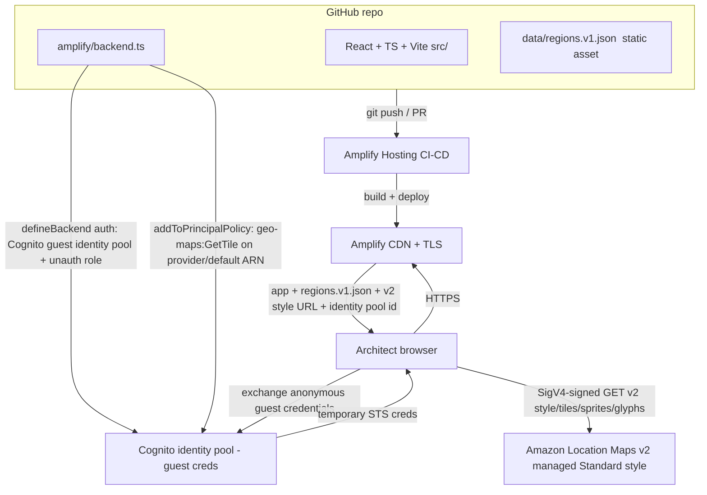

# AWS Region Resilience Explorer — Architecture

**Project:** AWS Region Resilience Explorer
**Event:** AWS Builder Center "Map It" hackathon
**Deadline:** 2026-11-02
**Author (owner):** map-architect
**Status:** DRAFT — awaiting lead review (gate before implementation)

> **Map-auth decision (FINAL — migration complete):** a Cognito
> **unauthenticated (guest) identity pool** is the **SOLE** map-auth mechanism.
> A direct SigV4 probe proved `geo-maps:GetTile` is rejected by an **implicit
> deny** (no identity-based policy allows the action), so the authorized path is
> a **principal with an explicit `geo-maps:GetTile` Allow** — the guest role
> supplies exactly that. The restricted Amazon Location API key has been
> **REMOVED** from the backend and the app; no key string ships to the browser.
> Verified end-to-end at the HTTP layer (guest-cred SigV4 `GetTile` → 200;
> `GetStaticMap` → 403, least privilege). See **§5** for the full Cognito
> security model and the implicit-deny evidence.
>
> **Related docs:** deployment, sandbox and release checklist live in
> `docs/DEPLOYMENT.md`; the branch/mirror/release workflow and the orphaned
> legacy key live in `docs/GIT_WORKFLOW.md`.

---

## 1. Product summary

An interactive world map that helps AWS architects *see* the geographic
separation between AWS Regions and reason about secondary Regions for
disaster recovery (DR).

The product delivers **insight**, not just markers:

1. Show AWS Regions on an interactive map.
2. Pick a **primary** Region.
3. Compare candidate **secondary** Regions.
4. Compute and draw approximate **great-circle (haversine)** distances.
5. Filter Regions by verified metadata (continent, launch year, AZ count, geography type).
6. Make it unmistakably clear that **distance alone is not resilience** —
   it is not latency, not fault isolation, not service availability, not compliance.

The disclaimer is a first-class product feature, not fine print. Honest
framing of what the map does and does not model is part of the real-world
usefulness we are judged on.

---

## 2. Required stack (design target)

| Layer | Choice |
|---|---|
| App framework | **AWS Amplify Gen 2** |
| Frontend | **React + TypeScript + Vite** |
| Hosting / CI-CD | **AWS Amplify Hosting** with **GitHub** CI/CD |
| Interactive map | **Amazon Location Service** (Maps) |
| Infra-as-code | **AWS CDK** constructs wired through `amplify/backend.ts` |
| Data | **Versioned static JSON** dataset of Region locations + metadata (see `DATA_CONTRACT.md`) |
| Shape | Primarily **static + serverless**; **no** unnecessary backend services (Lambda, API Gateway, DynamoDB) and **no** user auth |

**Final confirmed stack:** AWS Amplify Gen 2; React + TypeScript + Vite; Amazon
Location Service; GitHub CI/CD with Amplify Hosting; a versioned static JSON
dataset; no unnecessary backend services; and **no deployment without explicit
human approval** (see §7).

---

## 3. Service selection & justification

| Service | Why | Why not the alternative |
|---|---|---|
| **Amplify Gen 2** | TypeScript-first backend definition (`amplify/backend.ts`), per-branch cloud sandboxes, native GitHub CI/CD, and an escape hatch to raw CDK for resources Amplify has no first-class construct for (Location maps). Lowest-ceremony path from repo → deployed app. | Hand-rolled CDK app + separate hosting (S3/CloudFront) is more wiring and no CI/CD out of the box. SAM is Lambda-centric; we are static. |
| **Amplify Hosting** | Git-push-to-deploy, PR preview builds, managed TLS + CDN, atomic rollbacks. Free tier covers hackathon traffic. | Self-managed S3 + CloudFront needs manual invalidations and cert setup. |
| **Amazon Location Service Maps v2 (geo-maps)** | The judging criterion explicitly rewards use of Location Service. v2 serves a **managed** MapLibre Standard style (no per-account map resource), rendered by MapLibre GL JS, usage-based pricing with a free tier. We draw our own Region markers + great-circle lines as GeoJSON layers on top. **Migrated from classic maps** — the DEV/TEST account has an explicit deny on the classic v0 tile path (see §4). | Mapbox/Google would score worse against the "use of Amazon Location Service" criterion and add third-party billing. Classic Location maps are denied on this account. |
| **Amazon Cognito unauthenticated (guest) identity pool** (**sole map-auth mechanism**) | A direct SigV4 probe proved `geo-maps:GetTile` is rejected by an **implicit deny** — "no identity-based policy allows the action" (not an explicit Deny/SCP/permissions boundary). That means the authorized path is a **principal whose IAM policy explicitly allows `geo-maps:GetTile`**. A Cognito **guest role** is exactly such a principal: anonymous browser clients assume it via the identity pool and SigV4-sign tile requests. **No secret ships to the browser** (only the public identity pool id), and the grant is **least-privilege — `geo-maps:GetTile` only** on the single provider ARN. | A restricted Location API key was used earlier and **removed**: a key cannot satisfy the `GetTile` implicit-deny the same way without embedding a shippable credential string, and the guest-role path is both least-privilege and secret-free. The Cognito **User Pool** that `defineAuth` creates is unused (no login UI). |
| **AWS CDK (via Amplify)** | Amplify Gen 2 has no first-class Location primitive, so we reach the backend CDK stack and attach the **least-privilege `geo-maps:GetTile` inline policy** to the Cognito unauth role via `addToPrincipalPolicy`. v2 is managed, so there is **no `CfnMap`** and **no `CfnAPIKey`** — the only Location surface is the IAM grant on the guest role. One deploy, one IAM surface. | A separately-deployed CDK stack would split state and complicate cross-stack references. |
| **Static versioned JSON** | Region data changes rarely (new Region launches). Shipping it as a build-time asset = zero backend compute, zero query latency, trivially cacheable, diffable in git. | DynamoDB/API Gateway/Lambda would add cost, cold starts, and operational surface for data that is effectively a constant. |

**Net:** one Amplify app, the v2 managed Standard style (no per-account map
resource), one Cognito guest identity pool + unauth role (least-privilege
`geo-maps:GetTile` grant), one static JSON asset. **No API key** (removed), no
databases, no APIs, no servers to patch.

---

## 4. How Amplify Gen 2 integrates Amazon Location Service (Maps v2 / geo-maps)

Amplify Gen 2 defines the backend declaratively in `amplify/backend.ts`. Amplify
ships first-class `defineAuth`, `defineData`, etc., but **not** a Location map
primitive. The supported pattern is to reach the underlying CDK stack and add
the resource as a CDK construct.

**Migration — classic → Maps v2 (geo-maps).** This build has **migrated** from
classic Amazon Location Service maps (`AWS::Location::Map` + a `geo:GetMap*`
key) to **Amazon Location Service Maps v2** (the `geo-maps` service). **Why:**
the DEV/TEST account (<AWS_TEST_ACCOUNT_ID>, eu-west-1) carries an **explicit DENY on the
classic v0 tile path** — the classic `CfnMap` + key deployed cleanly but could
not serve tiles against this account. The v2 endpoint
(`https://maps.geo.eu-west-1.amazonaws.com/v2/styles/Standard/descriptor`)
returns real MapLibre style JSON and is the authorized path. The key
architectural consequence: **v2 is a MANAGED service — the Standard style is
provider-managed, so there is NO per-account map resource (`CfnMap`) to
create.** The only Location surface the backend provisions is a **Cognito guest
IAM grant** on the `geo-maps` provider (see §5).

**Map-auth: Cognito guest identity pool + auth-helper + MapLibre
`transformRequest`.** The authorized path for v2 tiles is a principal whose IAM
policy explicitly allows `geo-maps:GetTile` (an admin SigV4 call without that
Allow is rejected by an implicit deny — see §5). We supply that principal with a
Cognito **unauthenticated (guest) identity pool**: the browser exchanges
anonymous guest credentials and SigV4-signs each tile request. **There is no API
key.**

Flow:

1. In `amplify/backend.ts`, call `defineBackend({ auth })` with the Cognito auth
   resource (`amplify/auth/resource.ts`). `defineAuth` enables unauthenticated
   (guest) identities by default, creating an **identity pool** that mints
   anonymous credentials plus an **unauthenticated IAM role**. A User Pool is
   created to satisfy `defineAuth`'s type shape but is **unused** — there is no
   login UI.
2. Reach the backend CDK stack and attach a **least-privilege inline policy** to
   the guest role: `geo-maps:GetTile` **only**, on the single v2 provider ARN
   (`arn:aws:geo-maps:eu-west-1::provider/default` — note the **double colon**:
   geo-maps resources have **no account-id segment**, and `default` is the
   provider name for the Standard managed style). `GetStyleDescriptor` /
   `GetGlyphs` / `GetSprites` need **no** grant (200 for the managed style);
   `GetStaticMap` is intentionally **not** granted.
3. There is **no `CfnMap`** (v2 is managed) and **no `CfnAPIKey`** (removed). The
   only Location resource the backend deploys is the IAM grant on the guest role.
4. Surface only **non-secret** build-time outputs (`custom.mapStyleUrl` +
   `mapRegion`) so the React app can read the v2 style URL. The Cognito
   **identity pool id + region** are emitted automatically by `defineAuth` into
   `amplify_outputs.json` (the `auth` block); the frontend reads them to build
   the SigV4 `transformRequest`. **No secret and no key string** is ever
   surfaced.

```ts
// amplify/backend.ts (final shape — v2 geo-maps, Cognito guest identity pool, NO API key)
import { defineBackend } from '@aws-amplify/backend';
import { PolicyStatement } from 'aws-cdk-lib/aws-iam';
import { auth } from './auth/resource';

const backend = defineBackend({
  // Cognito guest/unauthenticated identity pool — the principal that carries
  // the explicit geo-maps:GetTile Allow. No login UI; User Pool unused.
  auth,
});

// v2 provider ARN — double colon (no account-id), provider `default` = Standard.
const mapProviderArn = 'arn:aws:geo-maps:eu-west-1::provider/default';

// Least-privilege Allow on the Cognito UNAUTHENTICATED (guest) role: the grant
// that resolves the GetTile implicit deny. GetTile ONLY; GetStaticMap NOT
// granted (least privilege). Descriptor/glyphs/sprites need no grant.
backend.auth.resources.unauthenticatedUserIamRole.addToPrincipalPolicy(
  new PolicyStatement({
    actions: ['geo-maps:GetTile'],
    resources: [mapProviderArn],
  }),
);

const geoStack = backend.createStack('geo');
const mapStyleUrl =
  'https://maps.geo.eu-west-1.amazonaws.com/v2/styles/Standard/descriptor';

// NO CfnAPIKey. Only non-secret config is surfaced. The Cognito identity pool
// id + region come from the `auth` block of amplify_outputs.json.
backend.addOutput({
  custom: {
    mapStyleUrl,
    mapRegion: geoStack.region,
  },
});
```

The React app uses MapLibre GL JS. It reads the **Cognito identity pool id +
region** from `amplify_outputs.json` and the **v2 style URL** from the `custom`
outputs, then uses **`@aws/amazon-location-utilities-auth-helper`**
(`withIdentityPoolId(...)` → `getMapAuthenticationOptions()`) to obtain a
MapLibre `transformRequest` that **SigV4-signs** each v2 style/tile/sprite/glyph
request with anonymous guest credentials — satisfying the explicit `GetTile`
Allow. The style URL carries **no `?key=`**. When no AWS config is present the
app falls back to a free **OSM raster** basemap. Our own data (Region markers,
selected primary, DR-candidate lines) is drawn as GeoJSON layers on top of the
basemap and is **fully client-side** from the static JSON asset.

**Backend dependency versions (tested to synthesize).** `amplify/package.json`
pins `@aws-amplify/backend ^1.25.1`, `@aws-amplify/backend-cli ^1.4.2`,
`aws-cdk-lib ^2.275.0`, `constructs ^10.6.0`. The earlier pins
(`@aws-amplify/backend 1.8.0` + `aws-cdk-lib 2.164.1`) **failed to synthesize**:
`backend-function` requires **cdk >= 2.257** for the `aws-cdk-lib/aws-scheduler-targets`
subpath export, which 2.164.1 does not provide. The bump is the minimum needed to
get a clean synth; `defineAuth` and the `aws-cdk-lib/aws-iam` `PolicyStatement`
used for the guest-role grant are present and typed in these pins.

### Component diagram



Everything served to the browser (app bundle + `regions.v1.json`) is static.
The only runtime AWS calls from the browser are exchanging anonymous Cognito
guest credentials and fetching map tiles from Location Service (Maps v2 managed
Standard style) with **SigV4-signed** requests — no API key, no secret.

---

## 5. Public map access & security

The map is **public** (anyone can load the site and see the basemap) and the
product has **no login**.

**Decision (FINAL): a Cognito unauthenticated (guest) identity pool is the SOLE
public map-access mechanism.** A restricted Amazon Location API key was used
during migration and has been **REMOVED** from the backend and the app — no key
string ships to the browser. The implicit-deny evidence below proves why a
Cognito guest role is the correct principal; the rest of this section is the
full guest-credential security model, the least-privilege grant, the browser
SigV4 flow, dev/prod separation and cost.

### Why Cognito — the implicit-deny evidence

A direct IAM SigV4 call (as an admin principal) to `geo-maps:GetTile` on the
managed Standard-style provider returns **403**:

```
User ... is not authorized to perform: geo-maps:GetTile on resource
arn:aws:geo-maps:eu-west-1::provider/default because no identity-based policy
allows the geo-maps:GetTile action
```

This is an **IMPLICIT deny — a missing Allow**, NOT an explicit `Deny`, NOT an
SCP, and NOT a permissions boundary. Confirmed by probing the other managed
Standard-style sub-resources:

| geo-maps action | Result without an explicit grant | Needs an Allow? |
|---|---|---|
| `geo-maps:GetStyleDescriptor` | **200** (even unauthenticated) | **No** |
| `geo-maps:GetGlyphs` | **200** (even unauthenticated) | **No** |
| `geo-maps:GetSprites` | 200 (managed style, same class as glyphs) | **No** |
| `geo-maps:GetTile` | **403 implicit deny** | **Yes — explicit Allow required** |

So the managed Standard style's **descriptor, glyphs and sprites are served
without any authorization**, but **tiles (`GetTile`) require a principal whose
identity-based IAM policy explicitly allows the action**. The fix is therefore
to supply exactly such a principal. A **Cognito unauthenticated (guest) role**
is precisely that: an IAM role whose policy we control and which anonymous
browser clients can assume via the identity pool.

### Architecture

- **Guest identities, no User Pool login UI.** `amplify/auth/resource.ts`
  declares `defineAuth({ loginWith: { email: true } })`. The `loginWith` is
  present **only to satisfy `defineAuth`'s required type shape** — Amplify Gen 2
  (`@aws-amplify/backend ^1.25.1`) exposes **no first-class guest-only option**,
  so this is the documented workaround. **No sign-in UI is built and the User
  Pool is intentionally unused.** The only path the product uses is the
  **unauthenticated (guest)** one.
- **Unauthenticated identities enabled.** The Amplify auth construct defaults to
  `allowUnauthenticatedIdentities: true`, so defining the resource creates an
  **identity pool that mints anonymous credentials** plus an **unauthenticated
  IAM role** we grant map access to.
- **Least-privilege unauth role grant.** In `amplify/backend.ts`:

  ```ts
  backend.auth.resources.unauthenticatedUserIamRole.addToPrincipalPolicy(
    new PolicyStatement({
      actions: ['geo-maps:GetTile'],
      resources: ['arn:aws:geo-maps:eu-west-1::provider/default'],
    }),
  );
  ```

  **`geo-maps:GetTile` ONLY** — the single action the implicit-deny evidence
  proved is required — scoped to the **single provider ARN** (double colon:
  geo-maps resources have no account-id segment; `default` is the Standard
  managed-style provider). **`GetStyleDescriptor` / `GetGlyphs` / `GetSprites`
  need NO grant** (they return 200 for the managed style). `GetStaticMap` is
  **intentionally NOT granted** — a guest-credential SigV4 call to
  `GetStaticMap` returns **403**, which is the deliberate least-privilege
  outcome (verified; see the security model below). It would be added **only if**
  a static-map feature is later required.

### Frontend flow (amazon-location auth helper + MapLibre transformRequest)

1. The app reads the **identity pool id + region** from `amplify_outputs.json`
   (emitted automatically by `defineAuth` under the `auth` block) and the
   **v2 style URL + region** from the `custom` outputs (`mapStyleUrl`,
   `mapRegion`).
2. It uses **`amazon-location-utilities-auth-helper`**
   (`withIdentityPoolId(identityPoolId)`) to exchange **anonymous Cognito guest
   credentials** (STS `GetCredentialsForIdentity`) and obtain a MapLibre
   `transformRequest`.
3. `getMapAuthenticationOptions()` yields the MapLibre `transformRequest`.
   MapLibre GL JS loads the managed Standard style; the helper's
   **`transformRequest` SigV4-signs each v2 request** (style/tile/sprite/glyph)
   with the guest credentials, satisfying the explicit `GetTile` Allow. The style
   URL is `https://maps.geo.eu-west-1.amazonaws.com/v2/styles/Standard/descriptor`
   with **no `?key=`** — authorization is the SigV4 signature, not a query-string
   key. Descriptor/glyphs/sprites load fine without any grant; signing them too
   is harmless.
4. **OSM raster fallback.** When no AWS config is present (`amplify_outputs.json`
   absent), the app falls back to a free **OpenStreetMap raster** basemap and
   runs with **zero AWS**.
5. Our own data (Region markers, great-circle lines) remains **client-side
   GeoJSON** drawn on top of the basemap.

### Cognito guest-credential security model

- **No secret ships to the browser.** Only **non-secret** config reaches the
  client: the **identity pool id**, **region**, and **v2 style URL**. The
  identity pool id is a public identifier designed to be embedded in client
  code. There is **no API key string**, no long-lived credential, no User Pool
  client secret (the public SPA client has none), and no raw key material. The
  style URL carries no `?key=`.
- **Temporary, scoped credentials only.** The browser holds short-lived STS
  credentials minted for the anonymous guest identity, whose IAM role allows
  **only `geo-maps:GetTile`** on the single provider ARN. There is no login, no
  cookies, no PII and no stored user data — no auth attack surface.
- **Least privilege, verified.** Guest-cred SigV4 `GetTile` returns **200** (a
  real tile); `GetStaticMap` returns **403** because it is not granted. That
  403 is the intended least-privilege boundary, not a defect. (HTTP-layer auth
  is fully verified; in-browser WebGL render is an open item — no browser was
  available in this environment. See `docs/DEPLOYMENT.md` §5.)
- **Worst case of a leaked config value** is a third party minting their own
  anonymous guest credentials and reading the same public Standard-style tiles
  (metered usage) — no data exposure, no writes, no access to any other
  resource or service.

### Dev vs prod separation

Dev (Amplify **sandbox**, `npx ampx sandbox`, DEV/TEST account <AWS_TEST_ACCOUNT_ID>,
eu-west-1) and prod (the **`master` Amplify pipeline**) each provision their
**own, independent identity pool, unauth role and grant** — distinct
CloudFormation resources in distinct stacks with distinct identity pool ids. The
sandbox identity pool is never promoted to production; each environment mints
its own guest credentials. The backend is account-agnostic — each environment
gets its own pool, unauth role and grant (see `docs/GIT_WORKFLOW.md` §5/§7).

### Cost

- **Cognito identity pool guest credentials are FREE** — there is **no charge**
  for unauthenticated (guest) identities or for the identity pool itself.
- **STS `GetCredentialsForIdentity` is not charged.** No User Pool MAU cost is
  incurred because the User Pool is unused (no sign-ins/MAUs).
- The only metered cost remains **map-tile requests** against Amazon Location
  Service, exactly as in §7 — Cognito adds **no new cost line**.

### The removed API key

The restricted `CfnAPIKey` (`region-explorer-map-key`) used during the migration
has been **removed** from the CDK/Amplify backend and from the app — it is no
longer stack-managed and is referenced by no code or `amplify_outputs.json`.
One copy remains **orphaned in the test account** because AWS refuses to delete a
Location API key until it has been inactive for 90 days; it is harmless
(referrer-locked, read-only, provider-scoped, unused) and self-expires
2027-01-28. See `docs/GIT_WORKFLOW.md` §6 for status and cleanup options — not
repeated here.

### Deploy-side IAM

The CI/CD deploy role is scoped to the app's CloudFormation stacks plus the
services the deploy touches (Amplify, Cognito/IAM for the identity pool + unauth
role, and the CDK-bootstrap roles). With the v2 migration and the API key
removed, the deploy needs **no `geo:CreateMap`** and **no `geo:CreateKey`** —
there is no per-account map resource and no key to provision. No broad admin.

---

## 6. Data sources, coordinate accuracy, provenance

AWS **publishes the Region list** (codes, human names, launch info, AZ counts)
but does **NOT publish exact datacenter coordinates** — datacenter locations are
deliberately not disclosed. Therefore:

- **Authoritative metadata sources** for Region identifiers + metadata are the
  **official AWS Global Infrastructure documentation** AND the **AWS Systems
  Manager public parameters** under `/aws/service/global-infrastructure/...`
  (queried via SSM `get-parameters-by-path` on the public namespace).
- Coordinates are **approximate region-city centroids** (the city/metro AWS
  names for the Region, e.g. us-east-1 → Northern Virginia area), **not**
  datacenter locations. Centroids come from a **clearly documented source with
  verified redistribution rights**; third-party datasets are **not** copied
  without checking licensing.
- Every record **documents its coordinate provenance** and **must not** claim to
  represent actual AWS datacenter locations.
- Every record carries a **provenance block**: `source`, `retrievedDate`,
  `accuracyNote`, `license` (see `DATA_CONTRACT.md`).
- The UI surfaces the caveat: markers are **approximate regional centroids**.

| Field | Source | Notes |
|---|---|---|
| Region code, human name, launch year, AZ count, geography type | AWS Global Infrastructure docs + SSM public parameters (`/aws/service/global-infrastructure/...`) | Authoritative; record `retrievedDate`. |
| lat / lon | Approximate city/metro centroid from a documented source with **verified redistribution rights** | **Approximate**, not datacenter. Record source + accuracy note per record. |
| country, continent | Derived from the Region's named location | Verifiable. |

Licensing/provenance is documented per dataset version in `DATA_CONTRACT.md`.
The dataset is a derived compilation; the provenance block names the upstream
source (AWS Global Infrastructure docs + SSM public parameters for metadata, a
redistribution-cleared centroid source for coordinates) and the license/terms
under which the compilation is published in-repo. **Do not copy third-party
datasets without verifying their license permits redistribution.**

---

## 7. Deployment approach & cost

- **Amplify Hosting + GitHub CI/CD.** Connect the GitHub repo; `master` is the
  production branch, feature branches get PR preview builds.
- **One backend deploy** per environment (Amplify sandbox for dev, Amplify
  pipeline for `master`). **Dev and prod each provision their own, separate
  Cognito identity pool + unauth role + `geo-maps:GetTile` grant** (§5). With the
  v2 migration there is **no `CfnMap`** (v2 is managed) and **no `CfnAPIKey`**
  (removed). See `docs/DEPLOYMENT.md` for the verified sandbox stack.
- **Least-privilege deploy.** The CI/CD deploy role is scoped to the app's
  CloudFormation stacks + the specific services used (Amplify, Cognito/IAM for
  the identity pool and unauth role, and the CDK-bootstrap roles the deploy
  needs). With the v2 migration and the API key removed, the deploy needs **no
  `geo:CreateMap`** and **no `geo:CreateKey`** — there is no per-account map
  resource and no key to provision. No broad admin.
- **No deploy without explicit human approval.** The lead gates the first
  production deploy. Mates do not deploy to AWS.

### Rough monthly cost at low (hackathon/demo) traffic

| Item | Estimate | Notes |
|---|---|---|
| Amplify Hosting | **~\$0 (target)** | Free tier covers build minutes + hosting/data transfer at demo scale. |
| Amazon Location Service (Maps) | **~\$0 (target)** | Free-tier map-tile allowance covers demo usage; request-based pricing beyond. |
| Cognito guest identity pool + guest STS credentials | **\$0** | No charge for unauthenticated (guest) identities or `GetCredentialsForIdentity`; the User Pool is unused (no MAUs). |
| Backend compute (Lambda/API/DB) | **\$0** | None provisioned — static + serverless by design. |
| Static JSON asset | **~\$0 (target)** | Served from the Amplify CDN as part of the bundle. |
| **Total (demo scale)** | **≈ \$0 / month — cost-optimization target** | Not guaranteed: real cost depends on map-tile request volume + build minutes and **can exceed free tier**. |

**$0/month is a cost-optimization target, not a guaranteed cost.** Cost scales
with map-tile requests and build minutes; both are expected to stay inside free
tier for a hackathon demo, but heavier traffic or more frequent builds can push
spend above the free-tier allowances.

---

## 8. Git repo structure & file ownership

Git **is** initialized. Branch **`feat/architecture`** is currently active
(no commits yet). Branch-per-mate; the lead merges to `master`.

| Mate | Owns | Branch |
|---|---|---|
| map-architect | `docs/` | `feat/architecture` |
| map-data | `data/` | `feat/data` |
| map-frontend | app root + `src/` (and `amplify/`) | `feat/frontend` |
| map-tester | `tests/` | `feat/tests` |

```
aws-map-it/
├─ docs/            # map-architect  (ARCHITECTURE.md, DATA_CONTRACT.md, MVP_PLAN.md)
├─ data/            # map-data       (regions.v1.json + generator/notes)
├─ src/             # map-frontend   (React + TS + Vite app)
├─ amplify/         # map-frontend   (backend.ts: Cognito guest identity pool + geo-maps:GetTile grant — v2 geo-maps, no CfnMap, no API key)
├─ tests/           # map-tester     (haversine, data-contract validation, UI)
├─ public/          # static assets (regions.v1.json may be copied/imported here)
└─ (amplify/vite/package manifests at root — map-frontend)
```

- **Branch-per-mate** keeps edits isolated; the lead integrates via PRs to `master`.
- **Git worktrees** let mates work concurrently in separate checkouts of the
  same repo without stashing/branch-switch churn.
- The **versioned JSON data contract** (`DATA_CONTRACT.md`) is the seam: map-data
  produces `data/regions.vN.json` to the schema; map-frontend consumes it. Both
  can proceed in parallel once the contract is approved.

---

## 9. Distance & resilience semantics

**Distance shown = great-circle (haversine) km** between two Region centroids.

The product MUST distinguish and warn against conflating three different things:

| Concept | Shown? | What it is | Why it is not the others |
|---|---|---|---|
| (a) Approximate great-circle distance | **Yes** | Straight-line km between approximate centroids | A geometric proxy only; based on approximate coords. |
| (b) Network latency | **No (not measured)** | Real RTT over the network | Non-linear with distance; depends on fiber paths, peering, routing — not modeled. |
| (c) True resilience / fault isolation | **No (not modeled)** | Blast radius, correlated failure, compliance, service availability | Depends on service footprint, data-residency law, provider design — not a function of distance. |

UI contract:

- The separation is always labeled **"approximate great-circle separation"**.
- A persistent **disclaimer** states distance ≠ latency ≠ resilience ≠
  compliance ≠ service availability.
- **Visualization:** a line drawn between the selected primary and a candidate
  secondary, plus a **ranked list of DR candidates by separation**.

This honesty is deliberate: it is what makes the tool trustworthy to real
architects and is explicitly in scope for the creativity/usefulness criterion.

---

## 10. Alignment with judging criteria

**Assumption (stated):** the four criteria are **equally weighted**:
(1) completeness/functionality, (2) use of Amazon Location Service/mapping,
(3) technical implementation + code quality, (4) creativity/real-world
usefulness. If the official rubric differs, the lead should re-weight before the
gate.

| Criterion | How the MVP scores | What raises the score |
|---|---|---|
| 1. Completeness / functionality | All six MVP features shipped end-to-end: show Regions, pick primary, compare secondaries, draw distances, filter by metadata, disclaimer. | Smooth empty/error states; URL-shareable selection; keyboard-accessible controls. |
| 2. Use of Amazon Location Service / mapping | Real Location Service Maps v2 basemap via Cognito guest-credential SigV4; custom GeoJSON layers for markers + great-circle lines. | Clean map styling, animated/curved great-circle arcs, hover tooltips, clustering at zoom-out. |
| 3. Technical implementation + code quality | TS throughout, Amplify Gen 2 + CDK construct, validated data contract, unit-tested haversine, CI/CD. | Schema validation in CI, test coverage on distance math + data loader, typed data model, lint/format gates. |
| 4. Creativity / real-world usefulness | Reframes "distance" into an honest DR-reasoning aid; the distance≠resilience framing is the differentiator. | Ranked DR shortlist, filter presets ("different continent, ≥3 AZ"), a short "how to actually pick a DR Region" explainer panel. |

---

## 11. Open Questions

| # | Question | Owner | Blocking gate? |
|---|---|---|---|
| OQ1 | Confirm the official judging rubric and weights (we assumed 4 equal criteria). | lead | No, but affects polish priorities |
| OQ2 | Map access mechanism. **RESOLVED (FINAL):** a **Cognito unauthenticated (guest) identity pool** is the **sole** map-auth mechanism — its unauth role carries a least-privilege `geo-maps:GetTile` Allow on the single v2 provider ARN `arn:aws:geo-maps:eu-west-1::provider/default`, and the browser SigV4-signs tile requests with anonymous guest credentials. The restricted API key was **removed** (no key string ships to the browser). Migrated classic → Maps v2 (geo-maps) because the account denies the classic v0 tile path. Verified: guest-cred `GetTile` → 200, `GetStaticMap` → 403 (see §4/§5, `docs/DEPLOYMENT.md`). | map-frontend | No |
| OQ3 | Which basemap style best shows global separation? **RESOLVED by v2 migration:** v2 serves the managed **Standard** style (`.../v2/styles/Standard/descriptor`); that is the authorized managed style on this account. | map-frontend / map-architect | No |
| OQ4 | Upstream source + license for Region metadata and coordinates. **RESOLVED:** metadata from AWS Global Infrastructure docs + SSM public parameters (`/aws/service/global-infrastructure/...`); coordinates are approximate city centroids from a documented, redistribution-cleared source; no third-party dataset copied without checking licensing; every record documents coordinate provenance and never claims datacenter locations (see §6). | map-data | **Yes — RESOLVED** |
| OQ5 | Region scope. **RESOLVED:** dataset = all operational commercial AWS Regions in the standard `aws` partition. GovCloud, China, announced-but-not-operational Regions, Local Zones, Wavelength Zones and Outposts are **out of scope**. | lead | **Yes — RESOLVED** |
| OQ6 | Do we show AZ-level or Region-level only? (MVP: Region-level.) | lead | No |

---

## 12. Risks

| # | Risk | Impact | Likelihood | Mitigation |
|---|---|---|---|---|
| R1 | Users read approximate centroids as datacenter locations. | Misleading DR decisions | Med | Persistent "approximate centroid" caveat + provenance in UI. |
| R2 | Users conflate distance with resilience/latency/compliance. | Wrong real-world advice | High | §9 disclaimer as a first-class feature; explainer panel. |
| R3 | Coordinate/metadata provenance or license unclear. | Legal/accuracy gap | Med | OQ4/OQ5 **resolved** (§6, §11); redistribution-cleared centroid source + per-record provenance block. |
| R4 | Public Cognito config (identity pool id) is read by a third party. | Unauthorized guest-credential tile reads on the v2 managed style | Low | No secret ships to the browser — only the public identity pool id. Guest STS credentials are temporary and the unauth role allows **only** `geo-maps:GetTile` on the single provider ARN (least privilege; `GetStaticMap` denied). Worst case is metered tile reads of the public Standard style — no data exposure, no writes. Dev and prod each have their own pool (§5). The orphaned legacy API key is referrer-locked, unused and expiring (`docs/GIT_WORKFLOW.md` §6). |
| R5 | Location Service / Amplify free-tier limits hit during judging traffic. | Cost or throttling | Low | $0/month is a target, not a guarantee (§7); request-based pricing, caching, demo-scale traffic; monitor. |
| R6 | Parallel mates diverge from the data contract. | Integration breakage | Med | Contract is the frozen seam; CI validates `regions.vN.json` against schema. |
| R7 | Scope creep (Places/Routes/auth/AZ detail). | Misses deadline | Med | Stack guardrails: static + serverless only; gate before implementation. |

---

*End of ARCHITECTURE.md. See `DATA_CONTRACT.md` for the JSON schema and
`MVP_PLAN.md` for phases, testing, and the approval gate.*
