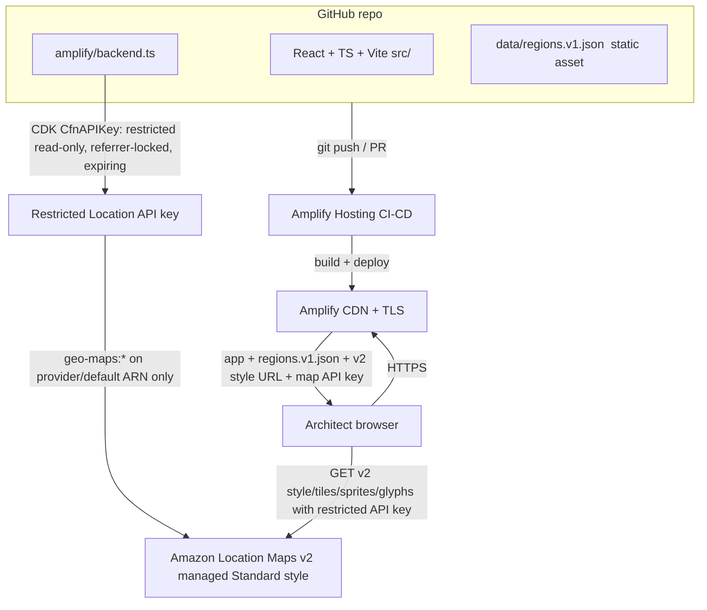

# AWS Region Resilience Explorer — Architecture

**Project:** AWS Region Resilience Explorer
**Event:** AWS Builder Center "Map It" hackathon
**Deadline:** 2026-11-02
**Author (owner):** map-architect
**Status:** DRAFT — awaiting lead review (gate before implementation)

> **Map-auth decision (FINAL):** The restricted Amazon Location Service API key
> is the **sole** public map-access mechanism. The unauthenticated Cognito
> identity pool has been **removed** from the backend (`amplify/auth/resource.ts`
> deleted; `defineBackend` no longer wires `auth`). The frontend reads the map
> style URL + API key from the generated config and never exchanges Cognito
> credentials. See §5.

---

## 1. Product summary

An interactive world map that helps AWS architects *see* the geographic
separation between AWS Regions and reason about secondary Regions for
disaster recovery (DR).

The product delivers **insight**, not just markers:

1. Show AWS Regions on an interactive map.
2. Pick a **primary** Region.
3. Compare candidate **secondary** Regions.
4. Compute and draw approximate **great-circle (haversine)** distances.
5. Filter Regions by verified metadata (continent, launch year, AZ count, geography type).
6. Make it unmistakably clear that **distance alone is not resilience** —
   it is not latency, not fault isolation, not service availability, not compliance.

The disclaimer is a first-class product feature, not fine print. Honest
framing of what the map does and does not model is part of the real-world
usefulness we are judged on.

---

## 2. Required stack (design target)

| Layer | Choice |
|---|---|
| App framework | **AWS Amplify Gen 2** |
| Frontend | **React + TypeScript + Vite** |
| Hosting / CI-CD | **AWS Amplify Hosting** with **GitHub** CI/CD |
| Interactive map | **Amazon Location Service** (Maps) |
| Infra-as-code | **AWS CDK** constructs wired through `amplify/backend.ts` |
| Data | **Versioned static JSON** dataset of Region locations + metadata (see `DATA_CONTRACT.md`) |
| Shape | Primarily **static + serverless**; **no** unnecessary backend services (Lambda, API Gateway, DynamoDB) and **no** user auth |

**Final confirmed stack:** AWS Amplify Gen 2; React + TypeScript + Vite; Amazon
Location Service; GitHub CI/CD with Amplify Hosting; a versioned static JSON
dataset; no unnecessary backend services; and **no deployment without explicit
human approval** (see §7).

---

## 3. Service selection & justification

| Service | Why | Why not the alternative |
|---|---|---|
| **Amplify Gen 2** | TypeScript-first backend definition (`amplify/backend.ts`), per-branch cloud sandboxes, native GitHub CI/CD, and an escape hatch to raw CDK for resources Amplify has no first-class construct for (Location maps). Lowest-ceremony path from repo → deployed app. | Hand-rolled CDK app + separate hosting (S3/CloudFront) is more wiring and no CI/CD out of the box. SAM is Lambda-centric; we are static. |
| **Amplify Hosting** | Git-push-to-deploy, PR preview builds, managed TLS + CDN, atomic rollbacks. Free tier covers hackathon traffic. | Self-managed S3 + CloudFront needs manual invalidations and cert setup. |
| **Amazon Location Service Maps v2 (geo-maps)** | The judging criterion explicitly rewards use of Location Service. v2 serves a **managed** MapLibre Standard style (no per-account map resource), rendered by MapLibre GL JS, usage-based pricing with a free tier. We draw our own Region markers + great-circle lines as GeoJSON layers on top. **Migrated from classic maps** — the DEV/TEST account has an explicit deny on the classic v0 tile path (see §4). | Mapbox/Google would score worse against the "use of Amazon Location Service" criterion and add third-party billing. Classic Location maps are denied on this account. |
| **Amazon Location Service restricted API key** (**sole mechanism**) | Simplest moving parts for a public, read-only, login-less map: a referrer/origin-restricted, read-only, expiring key bound to the single v2 **provider** ARN. No identity-pool wiring, no client credential exchange. | An unauth Cognito identity pool was evaluated and **removed** (see §5): it is more secure via IAM in the abstract but is unnecessary wiring when there is no login, and the frontend never used it. |
| **AWS CDK (via Amplify)** | Amplify Gen 2 has no first-class `defineMap`, so we add the `CfnAPIKey` as a CDK construct inside the Amplify backend. v2 is managed, so there is **no `CfnMap`** — the key is the only Location resource. One deploy, one IAM surface. | A separately-deployed CDK stack would split state and complicate cross-stack references. |
| **Static versioned JSON** | Region data changes rarely (new Region launches). Shipping it as a build-time asset = zero backend compute, zero query latency, trivially cacheable, diffable in git. | DynamoDB/API Gateway/Lambda would add cost, cold starts, and operational surface for data that is effectively a constant. |

**Net:** one Amplify app, the v2 managed Standard style (no per-account map
resource), one restricted API key, one static JSON asset. No identity pool, no
databases, no APIs, no servers to patch.

---

## 4. How Amplify Gen 2 integrates Amazon Location Service (Maps v2 / geo-maps)

Amplify Gen 2 defines the backend declaratively in `amplify/backend.ts`. Amplify
ships first-class `defineAuth`, `defineData`, etc., but **not** a Location map
primitive. The supported pattern is to reach the underlying CDK stack and add
the resource as a CDK construct.

**Migration — classic → Maps v2 (geo-maps).** This build has **migrated** from
classic Amazon Location Service maps (`AWS::Location::Map` + a `geo:GetMap*`
key) to **Amazon Location Service Maps v2** (the `geo-maps` service). **Why:**
the DEV/TEST account (<AWS_TEST_ACCOUNT_ID>, eu-west-1) carries an **explicit DENY on the
classic v0 tile path** — the classic `CfnMap` + key deployed cleanly but could
not serve tiles against this account. The v2 endpoint
(`https://maps.geo.eu-west-1.amazonaws.com/v2/styles/Standard/descriptor`)
returns real MapLibre style JSON and is the authorized path. The key
architectural consequence: **v2 is a MANAGED service — the Standard style is
provider-managed, so there is NO per-account map resource (`CfnMap`) to
create.** You only provision an **API key scoped to the geo-maps provider**.

Flow:

1. In `amplify/backend.ts`, create a backend CDK stack. There is **no `CfnMap`**
   for v2 — the Standard style is managed by the service, not a per-account
   resource.
2. Add a **`CfnAPIKey`** construct scoped to the **v2 provider ARN**
   (`arn:aws:geo-maps:eu-west-1::provider/default` — note the **double colon**:
   geo-maps resources have **no account-id segment**, and `default` is the
   provider name for the Standard managed style), **read-only** with
   `geo-maps:*` (see §5 for the least-privilege justification),
   **referrer/origin-restricted** to the Amplify Hosting domain(s), and carrying
   an **expiry** (see §5).
3. **No identity pool and no login.** Because the product has no authenticated
   users and the API key is the sole mechanism, `defineAuth` / an unauth role is
   **not** wired at all. `amplify/auth/resource.ts` has been **deleted** and
   `defineBackend` is called with no `auth` resource.
4. Surface the **v2 style descriptor URL**, Region, and the API key **name +
   ARN** as **build-time outputs** so the React app can read them (via
   `amplify_outputs.json` / a generated config), rather than hard-coding.
   (`CfnAPIKey` does not expose the raw key string as a CloudFormation
   attribute; the client resolves the key value at runtime from the generated
   config and appends `?key=<value>` to the style URL — see §5.)

Because the backend carries no `defineAuth`/`defineData` resource, `defineBackend`
is called with an **empty resource map** and the `geo` stack is created on the
returned backend; that stack (the lone `CfnAPIKey`) is the only resource the
backend deploys.

```ts
// amplify/backend.ts (final shape — v2 geo-maps, API-key-only, no Cognito)
import { defineBackend } from '@aws-amplify/backend';
import { CfnAPIKey } from 'aws-cdk-lib/aws-location';

const backend = defineBackend({}); // no auth/data — API key is the sole mechanism

const geoStack = backend.createStack('geo');

// v2 provider ARN — double colon (no account-id), provider `default` = Standard.
const mapProviderArn = 'arn:aws:geo-maps:eu-west-1::provider/default';
const mapStyleUrl =
  'https://maps.geo.eu-west-1.amazonaws.com/v2/styles/Standard/descriptor';

// Restricted, read-only, referrer-locked, EXPIRING key scoped to the v2 provider only.
const mapKey = new CfnAPIKey(geoStack, 'RegionExplorerMapKey', {
  keyName: 'region-explorer-map-key',
  noExpiry: false,
  expireTime: '2027-01-28T00:00:00Z', // rotate by redeploy (see §5)
  restrictions: {
    allowActions: ['geo-maps:*'],        // catch-all for a complete MapLibre style — see §5
    allowResources: [mapProviderArn],    // scoped to the single v2 provider ARN
    allowReferers: ['https://*.amplifyapp.com'], // bound to the Amplify Hosting domain
  },
});

backend.addOutput({
  custom: {
    mapStyleUrl,                              // v2 Standard style descriptor; client appends ?key=
    mapRegion: geoStack.region,
    mapApiKeyName: 'region-explorer-map-key', // raw key resolved client-side from config
    mapApiKeyArn: mapKey.attrKeyArn,
  },
});
```

The React app uses MapLibre GL JS. It reads the **v2 style descriptor URL** +
the **restricted API key** from the generated config, appends `?key=<value>`,
and fetches the managed Standard style (descriptor, vector tiles, sprites,
glyphs) directly — no credential exchange, no identity pool. Our own data
(Region markers, selected primary, DR-candidate lines) is drawn as GeoJSON
layers on top of the basemap and is **fully client-side** from the static JSON
asset.

**Backend dependency versions (tested to synthesize).** `amplify/package.json`
pins `@aws-amplify/backend ^1.25.1`, `@aws-amplify/backend-cli ^1.4.2`,
`aws-cdk-lib ^2.275.0`, `constructs ^10.6.0`. The earlier pins
(`@aws-amplify/backend 1.8.0` + `aws-cdk-lib 2.164.1`) **failed to synthesize**:
`backend-function` requires **cdk >= 2.257** for the `aws-cdk-lib/aws-scheduler-targets`
subpath export, which 2.164.1 does not provide. The bump is the minimum needed to
get a clean synth; `CfnMap` and `CfnAPIKey` (with `restrictions`/`expireTime`)
are present and typed in 2.275.0.

### Component diagram



Everything served to the browser (app bundle + `regions.v1.json`) is static.
The only runtime AWS call from the browser is fetching map tiles from Location
Service (Maps v2 managed Standard style) using the restricted API key.

---

## 5. Public map access & security

The map is **public** (anyone can load the site and see the basemap) and the
product has **no login**.

**Decision (FINAL): a restricted Amazon Location Service API key is the SOLE
public map-access mechanism.** An unauthenticated Cognito identity pool was
evaluated as a more-secure-in-the-abstract alternative and **removed** from the
backend. Reasoning:

1. The product has **no authenticated users**, so an identity pool exists only to
   mint anonymous credentials — ceremony with no login to serve.
2. The frontend **never used Cognito**: it loads the basemap from
   `VITE_MAP_STYLE_URL` with the API key and does no client-side credential
   exchange (confirmed).
3. The API key is the **simplest set of moving parts**: one resource, read
   straight from the generated config by MapLibre.
4. It is still **least-privilege** — scoped to the single v2 provider ARN,
   read-only (`geo-maps:*` is read-only; the service has only `Get*` actions —
   see §5(b)), and **referrer-locked** to the Amplify Hosting domain.
5. It is **rotatable by expiry**: the key carries an `expireTime` and is re-issued
   on rotation, with no long-lived write credential anywhere.

The unauth Cognito identity pool is therefore **not wired**. `amplify/auth/resource.ts`
has been deleted and `defineBackend` is called with no `auth` resource. If the
product ever adds login, an identity pool can be re-introduced then; it is not
carried as dormant wiring now.

### API-key usage & security model

The key is created by the `CfnAPIKey` construct in `amplify/backend.ts`
(`region-explorer-map-key`). It authorizes the **Maps v2 (geo-maps) managed
Standard style** — there is no per-account map resource, so the key is scoped to
the **provider ARN**, not a map ARN. Restrictions:

- **(a) Referrer restriction.** `allowReferers = ['https://*.amplifyapp.com']`
  binds the key to the Amplify Hosting domain(s). The wildcard is a **pre-deploy
  placeholder**: once the production Amplify domain (and any custom domain) is
  known, **narrow `allowReferers` to the real domain(s)** and redeploy. A key
  used from any other origin is rejected by Location Service.
- **(b) Read-only, single-provider scope — with a justified `geo-maps:*`
  exception.** `allowResources = ['arn:aws:geo-maps:eu-west-1::provider/default']`
  scopes the key to the **single v2 provider ARN** (double colon — geo-maps
  resources have no account-id segment; `default` is the Standard managed-style
  provider). `allowActions = ['geo-maps:*']`.

  **Why `geo-maps:*` rather than enumerated get-actions (least-privilege
  exception, per requirement 4).** A complete MapLibre vector Standard style is
  not one request: the renderer fetches **four** distinct sub-resources — the
  **style descriptor**, **vector tiles**, **sprites**, and **glyphs**. The
  individual v2 get-actions (`geo-maps:GetTile`, `geo-maps:GetStaticMap`,
  `geo-maps:GetGlyphs`, `geo-maps:GetSprites`, `geo-maps:GetStyleDescriptor`,
  …) do **not** cleanly cover every sub-resource the managed Standard style
  pulls, so an enumerated allow-list breaks the render. `geo-maps:*` is the
  **documented, supported** way to authorize a complete managed-style render.
  Critically, it is **still read-only**: the `geo-maps` service exposes **only
  `Get*` actions** — there are **no** write, create, update, or delete actions
  in the service at all. So the wildcard grants nothing beyond read access to
  this one provider; it is the **minimum** that serves the whole style while
  remaining read-only and scoped to a single provider ARN. There is still no
  Places/Routes/Trackers/Geofencing access (different services, not covered by
  `geo-maps:*`).
- **(c) Expiry & rotation.** `noExpiry = false` with a concrete
  `expireTime = '2027-01-28T00:00:00Z'` (a sensible sandbox lifetime).
  **Rotation procedure:** the key is rotated by **redeploying the backend with a
  new `expireTime`** (and, if a key value needs to be invalidated immediately,
  by changing `keyName` so a fresh key is issued). The client always reads the
  **current** key from the generated config (`amplify_outputs.json` → the
  `custom` outputs: `mapStyleUrl` + `mapApiKeyName`), so a rotation requires no
  code change — redeploy, and the new config carries the new key. There is no
  standing long-lived secret; the key self-expires if rotation lapses.
- **(d) DEV and PROD keys are SEPARATE.** The key provisioned by the Amplify
  **sandbox** (`npx ampx sandbox`) is a **dev-only** key, authorized solely
  against the DEV/TEST account (<AWS_TEST_ACCOUNT_ID>, eu-west-1, profile
  `<AWS_PROFILE>`). **Production uses its own, independent key**, provisioned by
  the **production Amplify app's** backend deploy on the `master` pipeline into
  the production account/stack. The two keys share the same construct definition
  (`region-explorer-map-key`) but are **distinct CloudFormation resources in
  distinct stacks with distinct key values and distinct referer locks** — the
  dev key never authorizes the production site and vice versa. The sandbox key
  is never promoted to production; each environment mints and rotates its own.
- **(e) The key string ships to the browser — and why that is acceptable.** A
  Location API key is designed to be embedded in client code; the raw string
  reaches the browser in the generated config. This is acceptable **because the
  restrictions above make a leaked key low-value**: it is read-only, usable only
  against this single v2 provider ARN, and only from the locked referrer domain,
  and it expires. The worst case of a leaked, off-domain-reused key is
  unauthorized map-tile/style reads on the managed Standard style (metered
  usage) — not data exposure, not writes, not access to any other resource.
  There is **no login, no cookies, no PII, no stored user data**, so there is no
  auth attack surface and nothing to leak beyond the restricted read capability
  itself.

Deployment-side: a **least-privilege deploy role** is used for the Amplify/CDK
deployment (see §7); the deploy principal needs `geo:CreateKey` /
`geo:UpdateKey` / `geo:DeleteKey` (plus the key describe actions) to provision
the key. Note that with the v2 migration **no `geo:CreateMap`** is needed — v2
has no per-account map resource to create.

---

## 6. Data sources, coordinate accuracy, provenance

AWS **publishes the Region list** (codes, human names, launch info, AZ counts)
but does **NOT publish exact datacenter coordinates** — datacenter locations are
deliberately not disclosed. Therefore:

- **Authoritative metadata sources** for Region identifiers + metadata are the
  **official AWS Global Infrastructure documentation** AND the **AWS Systems
  Manager public parameters** under `/aws/service/global-infrastructure/...`
  (queried via SSM `get-parameters-by-path` on the public namespace).
- Coordinates are **approximate region-city centroids** (the city/metro AWS
  names for the Region, e.g. us-east-1 → Northern Virginia area), **not**
  datacenter locations. Centroids come from a **clearly documented source with
  verified redistribution rights**; third-party datasets are **not** copied
  without checking licensing.
- Every record **documents its coordinate provenance** and **must not** claim to
  represent actual AWS datacenter locations.
- Every record carries a **provenance block**: `source`, `retrievedDate`,
  `accuracyNote`, `license` (see `DATA_CONTRACT.md`).
- The UI surfaces the caveat: markers are **approximate regional centroids**.

| Field | Source | Notes |
|---|---|---|
| Region code, human name, launch year, AZ count, geography type | AWS Global Infrastructure docs + SSM public parameters (`/aws/service/global-infrastructure/...`) | Authoritative; record `retrievedDate`. |
| lat / lon | Approximate city/metro centroid from a documented source with **verified redistribution rights** | **Approximate**, not datacenter. Record source + accuracy note per record. |
| country, continent | Derived from the Region's named location | Verifiable. |

Licensing/provenance is documented per dataset version in `DATA_CONTRACT.md`.
The dataset is a derived compilation; the provenance block names the upstream
source (AWS Global Infrastructure docs + SSM public parameters for metadata, a
redistribution-cleared centroid source for coordinates) and the license/terms
under which the compilation is published in-repo. **Do not copy third-party
datasets without verifying their license permits redistribution.**

---

## 7. Deployment approach & cost

- **Amplify Hosting + GitHub CI/CD.** Connect the GitHub repo; `master` is the
  production branch, feature branches get PR preview builds.
- **One backend deploy** per environment (Amplify sandbox for dev, Amplify
  pipeline for `master`). **Dev and prod each provision their own, separate
  restricted key** (§5(d)). The restricted `CfnAPIKey` deploys as part of the
  Amplify backend; with the v2 migration there is **no `CfnMap`** — v2 is
  managed. No Cognito identity pool is deployed.
- **Least-privilege deploy.** The CI/CD deploy role is scoped to the app's
  CloudFormation stacks + the specific services used (Amplify, Location, and the
  IAM/CDK-bootstrap roles the deploy needs). The Location permissions must
  include **`geo:CreateKey`** (a prior deploy failed only because the principal
  lacked it) alongside `geo:UpdateKey`/`geo:DeleteKey` and the key describe
  actions. With the v2 migration **no `geo:CreateMap`** is needed — there is no
  per-account map resource to create. No Cognito permissions are needed now that
  the identity pool is removed. No broad admin.
- **No deploy without explicit human approval.** The lead gates the first
  production deploy. Mates do not deploy to AWS.

### Rough monthly cost at low (hackathon/demo) traffic

| Item | Estimate | Notes |
|---|---|---|
| Amplify Hosting | **~\$0 (target)** | Free tier covers build minutes + hosting/data transfer at demo scale. |
| Amazon Location Service (Maps) | **~\$0 (target)** | Free-tier map-tile allowance covers demo usage; request-based pricing beyond. |
| Restricted Location API key | **\$0** | No charge for the key itself; tile requests billed as above. |
| Backend compute (Lambda/API/DB) | **\$0** | None provisioned — static + serverless by design. |
| Static JSON asset | **~\$0 (target)** | Served from the Amplify CDN as part of the bundle. |
| **Total (demo scale)** | **≈ \$0 / month — cost-optimization target** | Not guaranteed: real cost depends on map-tile request volume + build minutes and **can exceed free tier**. |

**$0/month is a cost-optimization target, not a guaranteed cost.** Cost scales
with map-tile requests and build minutes; both are expected to stay inside free
tier for a hackathon demo, but heavier traffic or more frequent builds can push
spend above the free-tier allowances.

---

## 8. Git repo structure & file ownership

Git **is** initialized. Branch **`feat/architecture`** is currently active
(no commits yet). Branch-per-mate; the lead merges to `master`.

| Mate | Owns | Branch |
|---|---|---|
| map-architect | `docs/` | `feat/architecture` |
| map-data | `data/` | `feat/data` |
| map-frontend | app root + `src/` (and `amplify/`) | `feat/frontend` |
| map-tester | `tests/` | `feat/tests` |

```
aws-map-it/
├─ docs/            # map-architect  (ARCHITECTURE.md, DATA_CONTRACT.md, MVP_PLAN.md)
├─ data/            # map-data       (regions.v1.json + generator/notes)
├─ src/             # map-frontend   (React + TS + Vite app)
├─ amplify/         # map-frontend   (backend.ts: restricted CfnAPIKey via CDK — v2 geo-maps, no CfnMap)
├─ tests/           # map-tester     (haversine, data-contract validation, UI)
├─ public/          # static assets (regions.v1.json may be copied/imported here)
└─ (amplify/vite/package manifests at root — map-frontend)
```

- **Branch-per-mate** keeps edits isolated; the lead integrates via PRs to `master`.
- **Git worktrees** let mates work concurrently in separate checkouts of the
  same repo without stashing/branch-switch churn.
- The **versioned JSON data contract** (`DATA_CONTRACT.md`) is the seam: map-data
  produces `data/regions.vN.json` to the schema; map-frontend consumes it. Both
  can proceed in parallel once the contract is approved.

---

## 9. Distance & resilience semantics

**Distance shown = great-circle (haversine) km** between two Region centroids.

The product MUST distinguish and warn against conflating three different things:

| Concept | Shown? | What it is | Why it is not the others |
|---|---|---|---|
| (a) Approximate great-circle distance | **Yes** | Straight-line km between approximate centroids | A geometric proxy only; based on approximate coords. |
| (b) Network latency | **No (not measured)** | Real RTT over the network | Non-linear with distance; depends on fiber paths, peering, routing — not modeled. |
| (c) True resilience / fault isolation | **No (not modeled)** | Blast radius, correlated failure, compliance, service availability | Depends on service footprint, data-residency law, provider design — not a function of distance. |

UI contract:

- The separation is always labeled **"approximate great-circle separation"**.
- A persistent **disclaimer** states distance ≠ latency ≠ resilience ≠
  compliance ≠ service availability.
- **Visualization:** a line drawn between the selected primary and a candidate
  secondary, plus a **ranked list of DR candidates by separation**.

This honesty is deliberate: it is what makes the tool trustworthy to real
architects and is explicitly in scope for the creativity/usefulness criterion.

---

## 10. Alignment with judging criteria

**Assumption (stated):** the four criteria are **equally weighted**:
(1) completeness/functionality, (2) use of Amazon Location Service/mapping,
(3) technical implementation + code quality, (4) creativity/real-world
usefulness. If the official rubric differs, the lead should re-weight before the
gate.

| Criterion | How the MVP scores | What raises the score |
|---|---|---|
| 1. Completeness / functionality | All six MVP features shipped end-to-end: show Regions, pick primary, compare secondaries, draw distances, filter by metadata, disclaimer. | Smooth empty/error states; URL-shareable selection; keyboard-accessible controls. |
| 2. Use of Amazon Location Service / mapping | Real Location Service basemap via a restricted API key; custom GeoJSON layers for markers + great-circle lines. | Clean map styling, animated/curved great-circle arcs, hover tooltips, clustering at zoom-out. |
| 3. Technical implementation + code quality | TS throughout, Amplify Gen 2 + CDK construct, validated data contract, unit-tested haversine, CI/CD. | Schema validation in CI, test coverage on distance math + data loader, typed data model, lint/format gates. |
| 4. Creativity / real-world usefulness | Reframes "distance" into an honest DR-reasoning aid; the distance≠resilience framing is the differentiator. | Ranked DR shortlist, filter presets ("different continent, ≥3 AZ"), a short "how to actually pick a DR Region" explainer panel. |

---

## 11. Open Questions

| # | Question | Owner | Blocking gate? |
|---|---|---|---|
| OQ1 | Confirm the official judging rubric and weights (we assumed 4 equal criteria). | lead | No, but affects polish priorities |
| OQ2 | Map access mechanism. **RESOLVED (FINAL):** a restricted Location Service API key is the **sole** mechanism (read-only `geo-maps:*`, referrer-locked to the Amplify domain, expiring, scoped to the single v2 provider ARN `arn:aws:geo-maps:eu-west-1::provider/default`). Migrated classic → Maps v2 (geo-maps) because the account denies the classic v0 tile path. The unauth Cognito identity pool was evaluated and **removed** from the backend — the frontend never used it (see §4/§5). | map-frontend | No |
| OQ3 | Which basemap style best shows global separation? **RESOLVED by v2 migration:** v2 serves the managed **Standard** style (`.../v2/styles/Standard/descriptor`); that is the authorized managed style on this account. | map-frontend / map-architect | No |
| OQ4 | Upstream source + license for Region metadata and coordinates. **RESOLVED:** metadata from AWS Global Infrastructure docs + SSM public parameters (`/aws/service/global-infrastructure/...`); coordinates are approximate city centroids from a documented, redistribution-cleared source; no third-party dataset copied without checking licensing; every record documents coordinate provenance and never claims datacenter locations (see §6). | map-data | **Yes — RESOLVED** |
| OQ5 | Region scope. **RESOLVED:** dataset = all operational commercial AWS Regions in the standard `aws` partition. GovCloud, China, announced-but-not-operational Regions, Local Zones, Wavelength Zones and Outposts are **out of scope**. | lead | **Yes — RESOLVED** |
| OQ6 | Do we show AZ-level or Region-level only? (MVP: Region-level.) | lead | No |

---

## 12. Risks

| # | Risk | Impact | Likelihood | Mitigation |
|---|---|---|---|---|
| R1 | Users read approximate centroids as datacenter locations. | Misleading DR decisions | Med | Persistent "approximate centroid" caveat + provenance in UI. |
| R2 | Users conflate distance with resilience/latency/compliance. | Wrong real-world advice | High | §9 disclaimer as a first-class feature; explainer panel. |
| R3 | Coordinate/metadata provenance or license unclear. | Legal/accuracy gap | Med | OQ4/OQ5 **resolved** (§6, §11); redistribution-cleared centroid source + per-record provenance block. |
| R4 | API key leaks or is reused off-domain. | Unauthorized tile/style reads on the v2 managed style | Low | Referrer-locked, read-only (`geo-maps:*` = Get* only), single-provider scope, expiry; rotate by redeploy with a new `expireTime` (§5). A leaked key is low-value: read-only, single-provider, domain-locked, expiring. Dev and prod keys are separate (§5(d)). An identity pool could be re-introduced if login is ever added. |
| R5 | Location Service / Amplify free-tier limits hit during judging traffic. | Cost or throttling | Low | $0/month is a target, not a guarantee (§7); request-based pricing, caching, demo-scale traffic; monitor. |
| R6 | Parallel mates diverge from the data contract. | Integration breakage | Med | Contract is the frozen seam; CI validates `regions.vN.json` against schema. |
| R7 | Scope creep (Places/Routes/auth/AZ detail). | Misses deadline | Med | Stack guardrails: static + serverless only; gate before implementation. |

---

*End of ARCHITECTURE.md. See `DATA_CONTRACT.md` for the JSON schema and
`MVP_PLAN.md` for phases, testing, and the approval gate.*
